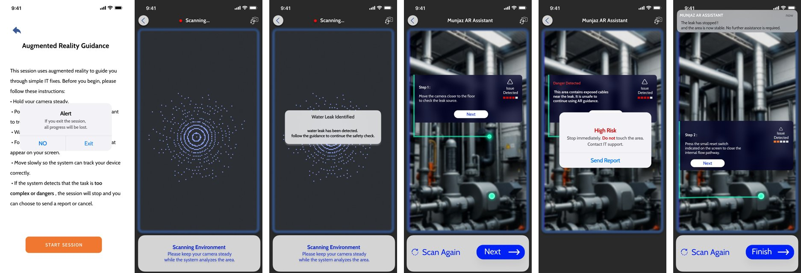
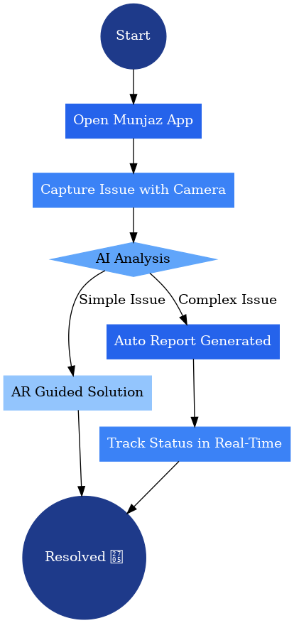
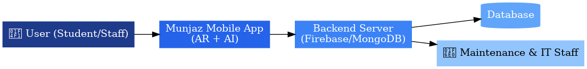
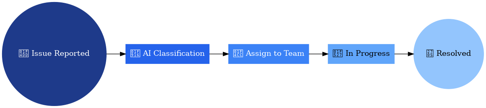

# 🛠️ Munjaz | مُنجَز

**An AR + AI + IoT mobile solution for smart campus facility management.**

Point your phone at a problem on campus, like a leak or a faulty device. Munjaz identifies the issue, guides you through simple fixes with augmented-reality instructions, and sends complex or dangerous issues to the right team with the exact location attached. You can follow your report in real time until it's resolved.

> Course project for **CS 513: Mobile Computing**, Imam Abdulrahman Bin Faisal University (IAU).
> Status: **concept & UI/UX design** (proposal, system design and interactive prototype screens).

<p align="center">
  
</p>

---

## ❗ The problem

Campus maintenance usually runs on phone calls and emails, which leads to:

1. **Inaccurate locations:** users can't describe exactly where the fault is.
2. **Overload of simple issues:** technicians spend time on problems users could fix themselves.
3. **No transparency:** users can't see what's happening with their report.
4. **Poor prioritization:** critical issues wait behind trivial ones.

## 💡 The solution

| | |
|---|---|
| 🤳 **Self-service with AR + AI** | AI recognizes minor issues and AR overlays step-by-step repair instructions on the camera view. |
| 🧭 **Accurate reporting** | For complex problems, AI classifies the issue and the report includes AR-pinpointed location data and photos, sent straight to the right department (maintenance, IT or services). |
| ⚠️ **Safety first** | If the system detects danger (for example exposed cables near a leak), it stops the guided session and escalates to experts. |
| 📡 **Real-time tracking** | Every report moves through *New → Self-Service → In Progress → Resolved*, visible to the user. |
| 🔮 **Predictive maintenance** | IoT sensors (temperature, vibration, energy use) feed AI that detects anomalies before failures happen. |
| ⚙️ **Smart task allocation** | Issues are prioritized and assigned to available technicians automatically. |

## 🔄 How it works

<p align="center">
  
</p>

<p align="center">
  <br>
  <sub>AR + AI integration</sub>
</p>

<p align="center">
  <br>
  <sub>Client–server architecture</sub>
</p>

<p align="center">
  <br>
  <sub>IoT & predictive maintenance</sub>
</p>

<p align="center">
  <br>
  <sub>Smart decision-making: issue lifecycle</sub>
</p>

## 🧩 Planned tech stack

| Layer | Technology |
|---|---|
| Mobile app | Android + **ARCore** (motion tracking, surface detection, spatial anchors) |
| AI | Image recognition & issue classification (on-device lightweight model or server-side) |
| Backend | Cloud server with **Firebase / MongoDB**, workflow tracking and user roles |
| IoT | Sensors for temperature, vibration and energy usage |
| Sensors used | Camera, gyroscope |

## 📱 AR guidance prototype

The AR Assistant screens walk through a full session:

1. **Pre-session checklist & safety alert:** hold the camera steady and make sure the area is safe.
2. **Scanning environment:** spatial mapping of the area.
3. **Issue detected:** for example, *"Water leak identified."*
4. **Guided repair:** AR markers highlight the valve or switch and give step-by-step instructions.
5. **Danger detection:** high-risk situations stop the session and send a report to IT/maintenance.
6. **Session summary:** completed steps, total time and a rating.

The full screen-by-screen analysis is in [`docs/ar-guidance-system-ui-flow.pdf`](docs/ar-guidance-system-ui-flow.pdf).

## 📁 Repository contents

```
.
├── docs/
│   ├── munjaz-project-proposal.pdf      # Problem, solution, objectives, technical design, references
│   ├── ar-guidance-system-ui-flow.pdf   # AR Assistant UI flow: every screen explained
│   └── images/                          # Diagrams and prototype screens used in this README
└── README.md
```

---

<details>
<summary>🇸🇦 ملخص بالعربي</summary>

**مُنجَز** تطبيق جوال مقترح لإدارة أعطال الحرم الجامعي بطريقة ذكية، باستخدام الواقع المعزز (AR) والذكاء الاصطناعي (AI) وإنترنت الأشياء (IoT).

يوجّه المستخدم كاميرا جواله على العطل، ويتعرف عليه الذكاء الاصطناعي. لو كان بسيط، يعرض له التطبيق خطوات الإصلاح فوق الكاميرا بالواقع المعزز. ولو كان معقد أو خطير، يرسل بلاغ للقسم المختص مع الموقع الدقيق والصور. ويقدر المستخدم يتابع حالة بلاغه لحظة بلحظة.

مشروع مادة CS 513 الحوسبة المتنقلة، جامعة الإمام عبدالرحمن بن فيصل.
</details>
